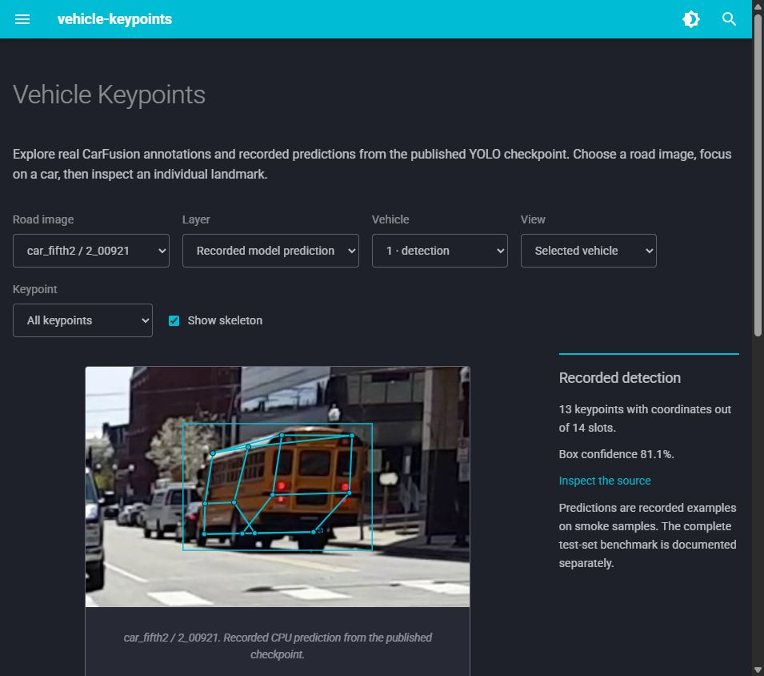

# Vehicle Keypoints

Detect 14 vehicle keypoints in road images, evaluate pose quality, and explore monocular 3D reconstruction and synthetic-data transfer.

[](https://github.com/kiselyovd/vehicle-keypoints/actions/workflows/ci.yml) [](https://kiselyovd.github.io/vehicle-keypoints/) [](https://huggingface.co/kiselyovd/vehicle-keypoints) [](LICENSE)

YOLO26-pose is the main detector; ViTPose-S is an under-trained reference baseline. The project includes scene-level data preparation, evaluation, FastAPI serving, and published weights.

[](https://kiselyovd.github.io/vehicle-keypoints/showcase/)

**[Explore the keypoints](https://kiselyovd.github.io/vehicle-keypoints/showcase/)** — switch between source images, dataset annotations, and recorded checkpoint predictions; focus on a vehicle or one landmark. The six examples are smoke samples with pinned provenance. [3D/PnP companion](docs/usage-guide.md#monocular-3d-pose-pnp-baseline).

[Model & weights](https://huggingface.co/kiselyovd/vehicle-keypoints) · [Documentation](https://kiselyovd.github.io/vehicle-keypoints/) · [Русский README](README.ru.md)

## Try the detector

Requires Python 3.13+ and [uv](https://docs.astral.sh/uv/). From the repository root:

Download the weights, then run inference:

```bash
uv sync --all-groups
uv run python -c "from huggingface_hub import hf_hub_download; print(hf_hub_download('kiselyovd/vehicle-keypoints', 'weights.pt', local_dir='artifacts/hf'))"
uv run python -m vehicle_keypoints.inference.predict \
  --checkpoint artifacts/hf/weights.pt --input data/sample/images/car_butler1__16_04881.jpg
```

This runs inference on a bundled CarFusion sample. Output is JSON with boxes, confidence scores, and 14 `(x, y, visibility)` keypoints per detection. Boxes use `(x, y, width, height)`.

## Results and research

Reported **2D** metrics on the CarFusion test split: **12,761 images**, OKS sigmas `0.05`, PCK threshold `0.05` of the box diagonal.

| Model | OKS-mAP | OKS-mAP50 | PCK@0.05 |
|---|---|---|---|
| YOLO26-pose | 50.4% | 70.4% | 76.1% |
| ViTPose-S reference | 0.1% | 0.4% | 13.7% |

See [stored metrics](reports/metrics_summary.json) and the [evaluation notes](docs/usage-guide.md#results). The ViTPose run used 15 epochs and `val=train`; these numbers do not establish a fair comparison of architecture capacity.

The [UE5 pipeline](https://github.com/kiselyovd/ue5-vehicle-synth) supplies synthetic frames and a compatible 24-point schema. In the published matched experiments, adding synthetic data reduced real-data OKS-mAP by **1.7 pp** from the weak checkpoint and **9.5 pp** from the strong checkpoint. The **+2 pp** acceptance criterion was not met. The [experiment report](docs/phase0/synthetic-pretraining.md) separates this result from the much larger gain caused by correcting horizontal-flip labels.

## Documentation

| Guide | Covers |
|---|---|
| [Usage and evaluation](docs/usage-guide.md) | Dataset, training commands, Python API, 3D pose, and evaluation caveats |
| [Architecture](docs/architecture.md) | Components and data flow |
| [Training](docs/training.md) | Detector and baseline recipes |
| [Serving](docs/serving.md) | FastAPI and Docker |
| [Synthetic-data experiment](docs/phase0/synthetic-pretraining.md) | Matched ablations, negative results, and follow-up hypotheses |

## Limitations and licenses

Research and education use. CarFusion is a limited traffic-scene dataset, and the 3D baseline has substantial domain shift and limited detector coverage.

Repository code is [MIT](LICENSE). CarFusion, ApolloCar3D, Ultralytics, and published model artifacts have separate terms; consult their licenses and model cards before reuse.
