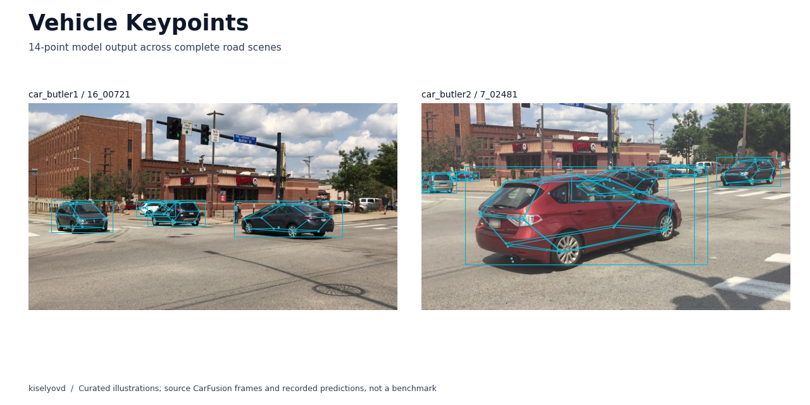

# Ключевые точки автомобилей

Детекция автомобилей и 14 ключевых точек кузова на дорожных кадрах. Основная модель — YOLO26-pose; исследовательские дополнения — monocular 3D/PnP и перенос с синтетических данных.

[CI](https://github.com/kiselyovd/vehicle-keypoints/actions/workflows/ci.yml) · [Документация](https://kiselyovd.github.io/vehicle-keypoints/) · [Модель](https://huggingface.co/kiselyovd/vehicle-keypoints) · [Лицензии компонентов](docs/LICENSES.md)

[](https://huggingface.co/spaces/kiselyovd/vehicle-keypoints-demo)

**[Запустить на своём кадре](https://huggingface.co/spaces/kiselyovd/vehicle-keypoints-demo)** · [Просмотрщик разметки и записанных предсказаний](https://kiselyovd.github.io/vehicle-keypoints/showcase/)

Результаты берутся из [единого отчёта](reports/metrics.json): [актуальная таблица и границы оценки](README.md#current-artifact-and-evaluation). Это сохранённая оценка CarFusion; полный benchmark в этом аудите не перезапускался. Иллюстрации в просмотрщике не являются test-набором. Исходный состав training-выборки не зафиксирован.

## Попробовать

Из корня репозитория, Python 3.13+ и uv:

```bash
uv sync --all-groups
uv run python -c "from huggingface_hub import hf_hub_download; print(hf_hub_download('kiselyovd/vehicle-keypoints', 'weights.pt', revision='d277c2d8c9b5ee49d9fed85fe43bdd72b16a0f06', local_dir='artifacts/hf'))"
uv run python -m vehicle_keypoints.inference.predict --checkpoint artifacts/hf/weights.pt --input data/sample/images/car_butler1__16_04881.jpg
```

Результат — JSON: bbox `(x, y, width, height)`, score и 14 точек `(x, y, score)` для каждой машины. Веса, checkpoint SHA256, preprocessing и происхождение метрик записаны в [artifact manifest](artifact-manifest.json).

## Исследования и документация

[Обучение, оценка и API](docs/usage-guide.md) · [Синтетическое предобучение](docs/phase0/synthetic-pretraining.md) · [Английский README](README.md) · [Цитирование](CITATION.cff)

Исследовательский проект. Перекрытия, обрезанные машины и необычные ракурсы приводят к пропускам и ошибкам. Код MIT; CarFusion, ApolloCar3D, Ultralytics и опубликованные веса имеют отдельные условия. Демо не является самостоятельным сенсором автономного вождения.
