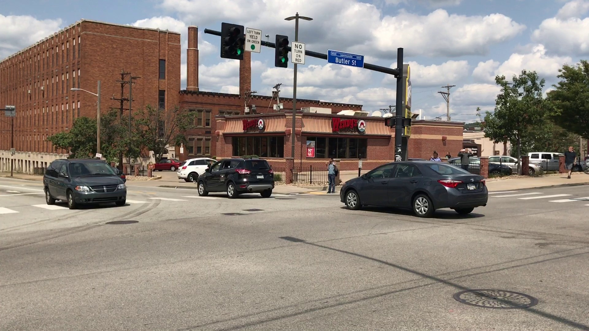

# Vehicle Keypoints

[Run the model on your own image](https://huggingface.co/spaces/kiselyovd/vehicle-keypoints-demo) · [Source-code and reproducible commands](https://github.com/kiselyovd/vehicle-keypoints)

Explore real CarFusion annotations and recorded predictions from the published YOLO checkpoint. Start with every labelled vehicle in a scene, then select a car or an individual landmark.

<section class="sc-explorer" data-showcase="vehicle" data-owner="kiselyovd" aria-label="Vehicle Keypoints interactive showcase">
  

  

    <figure class="sc-stage"><figcaption>Explore real CarFusion annotations and recorded predictions from the published YOLO checkpoint. Start with every labelled vehicle in a scene, then select a car or an individual landmark.</figcaption></figure>
    <aside class="sc-details"><h3>Explore the example</h3>
Use the controls to inspect this project's published artifacts.
</aside>
  

  
The source example is available above; interactive controls load when JavaScript is enabled.

  
</section>

**All vehicles** is the default view. Both it and **Full road frame** draw every object in the selected layer; **Selected vehicle** zooms to one object. Numbers correspond to the vehicle selector.

## What the layers mean

- **Dataset annotations:** the original 14-point CarFusion schema. Filled points are visible; hollow points are self-occluded.
- **Recorded model prediction:** locally recorded outputs on six curated traffic scenes, with 3–7 detections per scene. Point scores and box confidence come from the checkpoint.
- **Original photo:** the same source pixels with no annotation layer.

The six scenes contain 33 original dataset annotations. They were selected from the raw training release for clear multi-vehicle illustrations; one scene (`car_craig2`) belongs to the project validation partition. This is a curated selection, not a random test sample.

The model revision, checkpoint hash, image hashes, CPU configuration, and source annotation records are stored in the structured data. These examples are separate from the full CarFusion benchmark of 12,761 images. [Evaluation and limitations](usage-guide.md#results).

CarFusion retains its own research-use terms. The UI does not alter the original images or dataset labels.

## Sources and reproduction

The explorer uses published artifacts from [kiselyovd/vehicle-keypoints](https://github.com/kiselyovd/vehicle-keypoints). [Inspect the pinned source](https://github.com/kiselyovd/vehicle-keypoints/blob/7b05b7fb4654d9d1c1b1668752524a37eeba88d8/docs/assets/showcase/source-records.json) and the [structured showcase data](assets/showcase/data.json).

## See also

- [Project overview](index.md)
- [Architecture](architecture.md)
- [Source repository](https://github.com/kiselyovd/vehicle-keypoints)

## Difficult overlap example

The [live Space](https://huggingface.co/spaces/kiselyovd/vehicle-keypoints-demo) includes `car_fifth2 / 7_06521`: three dataset-labelled vehicles with overlapping silhouettes. In the pinned CPU replay only the foreground car has a returned box; the two vehicles behind it are missed. Inspect the source/prediction pair, rather than treating the curated example as an aggregate failure rate.
