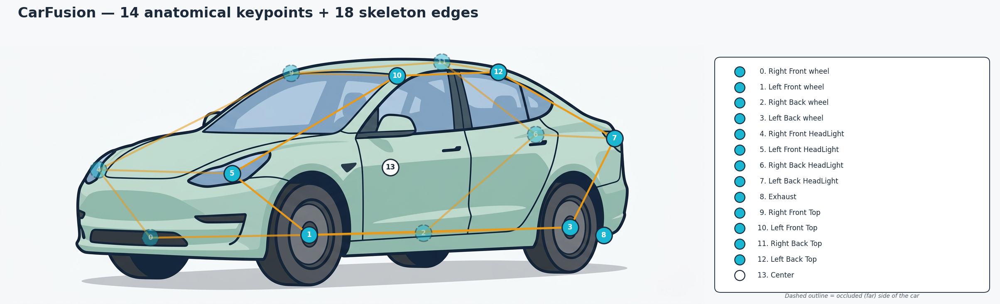
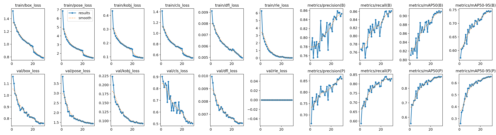
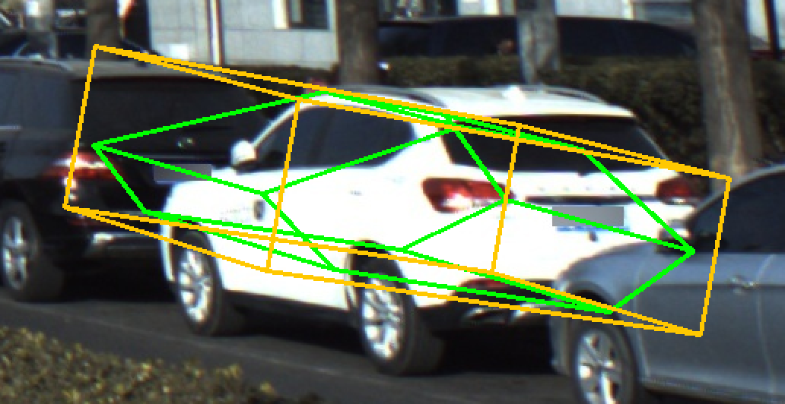

[Back to README](https://github.com/kiselyovd/vehicle-keypoints/blob/main/README.md) · [Architecture →](architecture.md)

# Usage and evaluation guide

## Dataset

[CarFusion](http://www.cs.cmu.edu/~mvo/index_files/CarFusion.html) - a multi-view traffic-scene dataset from Carnegie Mellon University (Dinesh Reddy, Minh Vo, and Srinivasa Narasimhan, CVPR 2018) with **14 keypoint annotations per car**. The raw release is pre-converted to COCO-keypoints JSON via `scripts/convert_carfusion_to_coco.py`, and `src/vehicle_keypoints/data/prepare.py` applies a **scene-level 90/10 split** across the 8 training scenes (val = `car_craig2`, the other 7 go to train) so no scene appears in more than one partition.

Resulting image counts: **16,713 train / 3,474 val / 12,761 test**. CarFusion is © CMU and released under its own research-only license.

## Results

Test-set metrics on CarFusion test split (12 761 images, 42 706 predictions):

| Model | OKS-mAP | OKS-mAP50 | PCK@0.05 |
|---|---|---|---|
| **YOLO26-pose** (main) | **50.4%** | **70.4%** | **76.1%** |
| ViTPose-S (baseline) | 0.1% | 0.4% | 13.7% |

OKS computed via pycocotools with uniform `kpt_oks_sigmas=0.05` (CarFusion has no established anatomical sigma calibration for 14 non-human keypoints); PCK@0.05 with a bbox-diagonal threshold. ViTPose-S baseline is **honestly under-trained** (15 epochs, `val=train` in `scripts/finalize_v010.py`, 85M params typically need 100+ epochs) - kept as a reference point but not representative of ViTPose capacity. See `reports/metrics_summary.json` for the full numbers.

## Visualizations

14-keypoint CarFusion skeleton (wheels, head- and tail-lights, roof corners, exhaust, body centre):



Flip-augmentation fix - left/right keypoints are correctly swapped under horizontal flip:



## Monocular 3D pose (PnP) baseline

The 14 keypoints lift to a full **6DoF vehicle pose** by solving PnP (`cv2.solvePnPRansac`) against a single rigid metric car wireframe - the first 14 points of the [ue5-vehicle-synth](https://github.com/kiselyovd/ue5-vehicle-synth) 24-point schema. We run the CarFusion detector on the real [ApolloCar3D](http://apolloscape.auto/car_instance.html) validation split (272 frames) and compare the monocular PnP pose against ApolloCar3D's 3D ground-truth car poses:

| Metric | Value |
|---|---|
| Rotation error, median | **13.6°** |
| Rotation error, mean | 51.6° |
| Translation error, median | 3.13 m |
| Cars within 10° rotation | 37.8% |
| Cars within 2 m translation | 35.7% |
| Matched cars / detector hit-rate | 230 / 25.1% |



Honest caveats: this is a **single mean-sedan wireframe** (real cars vary in size and shape, an intrinsic error source), and the detector is trained on **CarFusion** then evaluated on **ApolloCar3D** - a real domain shift, which is why the hit-rate is 25% (ApolloCar3D also labels every distant and parked car). The model-to-Apollo frame alignment is a fixed rotation calibrated by SO(3) rotation averaging over matched cars (median rotation error 109° -> 16° on the calibration subset). The high rotation mean is the tail of PnP front/back flip ambiguities. This rigid-PnP baseline is the geometric foundation for the next milestone - a trainable, shape-aware monocular 3D model. Reproduce with `uv run python scripts/eval_pose3d.py`; numbers in `reports/pose3d_apollo.json`.

3D ground truth from the [ApolloScape 3D Car Instance](http://apolloscape.auto/car_instance.html) dataset (the ApolloCar3D benchmark, Song et al., CVPR 2019) - 79 CAD car types with per-car 6DoF poses and `RIEGL-CS6` camera intrinsics; research-only license. We use only its 3D pose ground truth, not the CAD shapes.

## Synthetic data: ue5-vehicle-synth

The 24-point schema and synthetic training data come from the sister project [`ue5-vehicle-synth`](https://github.com/kiselyovd/ue5-vehicle-synth), which generates keypoint-labeled vehicle frames inside Epic's City Sample (Unreal Engine 5).


> Demo: each scene is a single vehicle driving normally, then with its 24-point keypoint skeleton, then as a wireframe ghost. Full video and pipeline at [`ue5-vehicle-synth`](https://github.com/kiselyovd/ue5-vehicle-synth).

## Quick Start

```bash
uv sync --all-groups
bash scripts/sync_data.sh "D:/ProjectsData/Car Key Point/datasets/carfusion"
uv run python -m vehicle_keypoints.data.prepare --raw data/raw --out data/processed
make train     # main YOLO26-pose (~90 min RTX 3080)
make evaluate  # OKS-mAP + PCK on test
make serve     # FastAPI on :8000
```

## Full Training Commands

**Main - YOLO26-pose:**

```bash
uv run python -m vehicle_keypoints.training.train +experiment=sota trainer.max_epochs=100
```

**Baseline - ViTPose-S (top-down, Lightning):**

```bash
uv run python -m vehicle_keypoints.training.train_vitpose model=baseline trainer.max_epochs=30
```

## Inference

```python
from huggingface_hub import hf_hub_download
from vehicle_keypoints.inference.predict import Detector

ckpt = hf_hub_download(
    repo_id="kiselyovd/vehicle-keypoints", filename="weights.pt",
    revision="d277c2d8c9b5ee49d9fed85fe43bdd72b16a0f06",
)
det = Detector.from_checkpoint(ckpt)
detections = det.predict("car.jpg")
for d in detections:
    print(d["bbox"], d["score"], len(d["keypoints"]))
```

Each detection is a dict with an `(x, y, width, height)` `bbox`, a detector `score`, and a list of 14 `(x, y, score)` keypoints aligned to the CarFusion skeleton.

## Serving

```bash
docker compose up api
```

JSON response (keypoints + boxes):

```bash
curl -X POST -F file=@car.jpg http://localhost:8000/detect
```

Overlay PNG (skeleton drawn on the input image):

```bash
curl -X POST -F file=@car.jpg "http://localhost:8000/detect?overlay=true" -o overlay.png
```

## Project Structure

```
vehicle-keypoints/
├── configs/              # Hydra
├── data/                 # raw + processed + sample (CI)
├── docs/                 # MkDocs Material
├── scripts/              # convert_carfusion_to_coco.py, build_sample_data.py, publish_to_hf.py, ...
├── src/vehicle_keypoints/
│   ├── data/             # prepare.py, coco_dataset.py, datamodule.py
│   ├── models/           # factory.py, vitpose.py, lightning_module.py
│   ├── training/         # train.py (YOLO), train_vitpose.py (Lightning)
│   ├── evaluation/       # evaluate.py (OKS-mAP + PCK)
│   ├── inference/        # predict.py, overlay.py
│   └── serving/          # FastAPI /detect
└── tests/
```

## Intended Use

Computer-vision research and education only. CarFusion is small, single-domain, and not representative of all driving conditions. **Not suitable as a primary sensor for autonomous driving; not safety-certified.**

## License

Repository code is [MIT](https://github.com/kiselyovd/vehicle-keypoints/blob/main/LICENSE). CarFusion and ApolloCar3D have their own research-use terms. The Ultralytics dependency and model artifacts have separate licensing terms; review those alongside the model card before reuse.

## See also

- [Training](training.md)
- [Serving](serving.md)
- [Synthetic pre-training experiment](phase0/synthetic-pretraining.md)
